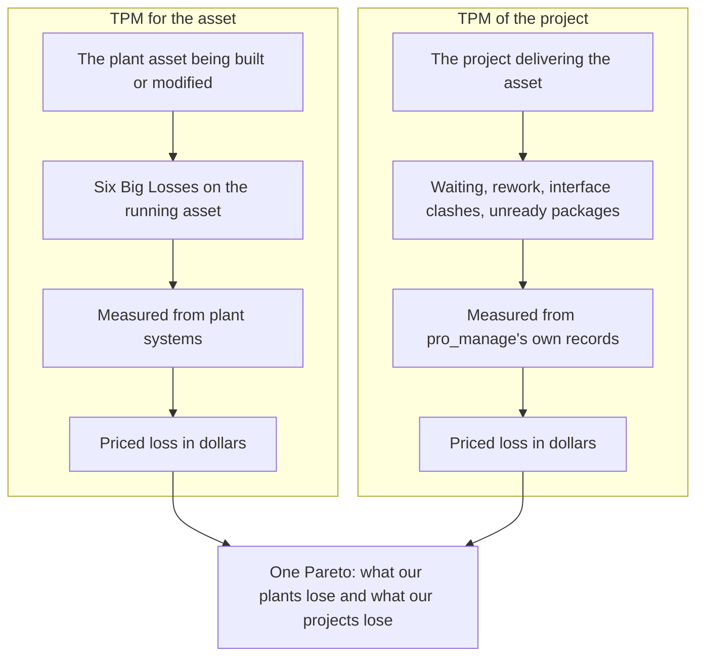
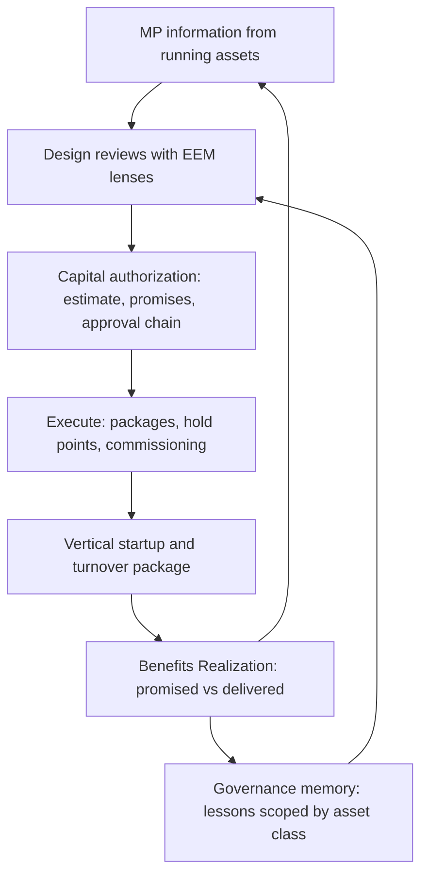
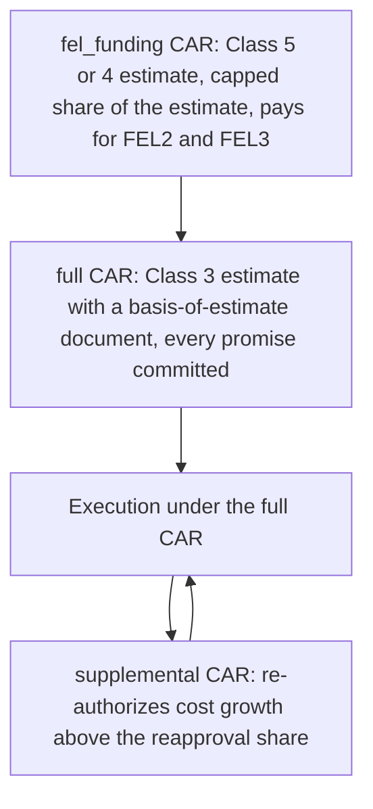
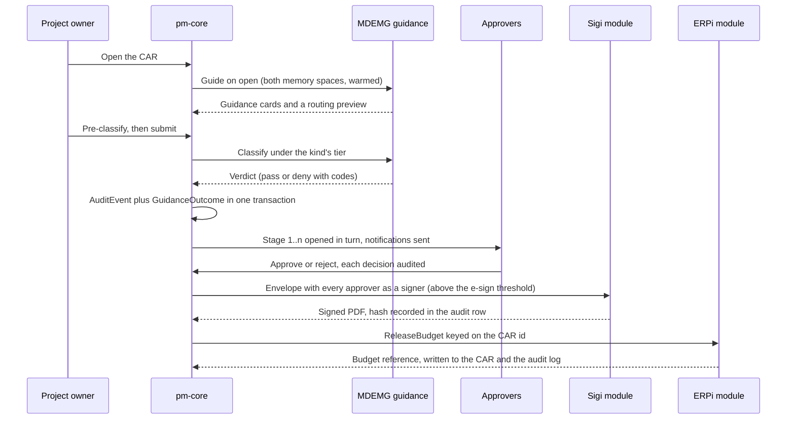
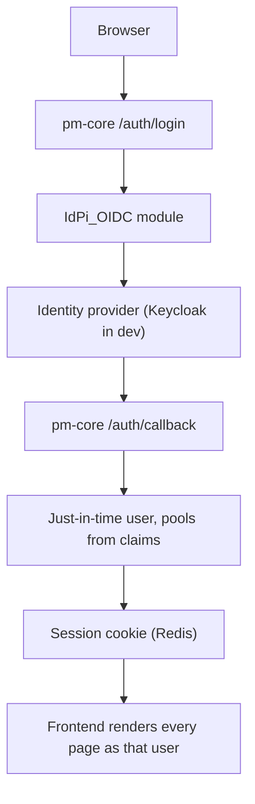
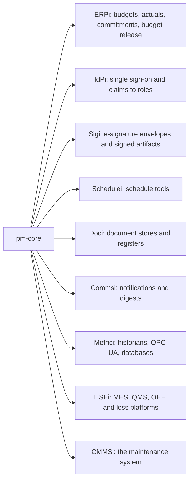
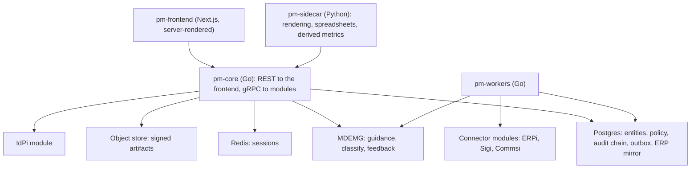
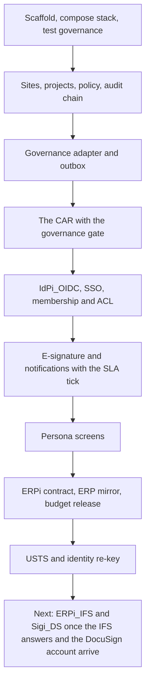

# pro_manage: Owner-Side Capital-Project Management for TPM-Driven Process Industries

This is the onboarding tutorial for pro_manage. It is built from `docs/tutorial.md` by tutorial-forge into one scrollable page with a navigation sidebar; the sidebar lists every section and every diagram. Read it top to bottom the first time, then use the sidebar to come back to the part you need.

The product is being built one reviewed slice at a time against a Functional Specification Document (FSD) in `docs/fsd/`. Where this tutorial says "today", it means the state of the `main` branch; where it says "layer", it means something the FSD describes that is pulled in when a pilot project needs it.

---

## P1 · Welcome

pro_manage carries a capital project from Front-End Loading (FEL) through Vertical Startup to Benefits Realization, and makes the Total Productive Maintenance (TPM) loop legible, auditable, and inheritable from one project to the next.

The organizing question, phrased the way a plant manager would:

> *"Did the asset start up clean, and did Operations and Maintenance inherit something they could run?"*

Every capability, workflow, and metric in pro_manage ties back to that question. It is a single-company system, hosted on the company's own network in containers, sized for 100 to 500 users across a few hundred concurrent capital projects, from a $25,000 refurbishment to a $250,000,000 greenfield.

**Who it is for.** Distilling, bottling, food and beverage manufacturing, chemicals, and similar process industries where TPM is the operating language and capital projects are run by the owner with EPCM and contractor partners.

note:
If you are presenting this deck live, the one sentence to land in P1 is the organizing question. Everything later is an answer to it.

---

## P2 · What You Will Learn

This tutorial walks through:

- **What pro_manage is**, and the idea it is built around: the project as equipment.
- **The TPM loop** from running assets back into design, and how pro_manage closes it.
- **The capital authorization chain**: the CAR, its estimate and promises, the approval stages, governance guidance, e-signature, and the budget release into the ERP.
- **Who does what**: the personas, how access works, and the one screen each persona uses.
- **How it fits the systems the company already runs**: the nine connector types and the ones built so far.
- **The architecture and the development stack**, so a new teammate can run it in half an hour.
- **How quality is governed**: contract specs with hashes, an append-only audit chain, and security tests that gate every merge.
- **Where the build stands** and what comes next.

Each section ends where a reader could stop and still have a complete picture of that part.

---

## P3 · The Project as Equipment

A TPM plant does not accept "the line was slow this week" as an explanation. It knows what share of planned time the line ran, how fast it ran against design, and how much of what it made was right the first time. It names every loss, prices it, ranks it, and assigns a team to the biggest one. Losses shrink because they are visible.

Capital projects almost never get this treatment. A project's health is usually reported as two variances, cost and schedule, which say how far off the project is but not where the time and money went. The days waiting for an RFI answer, the week a crew stood by because a work package started without its materials, the rework after a failed hold point, the month a change order sat in an approval queue: these are real, recurring, measurable losses, and they disappear into "schedule slip".

**The thesis: the project is the equipment.** Its work fronts are the machines, its work packages are the production runs, and its losses can be categorized, measured, priced, and attacked with the same discipline, and the same eight pillars, that TPM applies on the plant floor.

That gives pro_manage two views of TPM on one system, priced in the same dollars:



The analogy is made concrete in three places:

| OEE component | Plant meaning | Project counterpart |
|---|---|---|
| Availability | Run time over planned production time | **Work-front availability**: time a released package was actually workable, lost to waiting on information, approvals, materials, permits, or safety stops |
| Performance | Actual rate over design rate | **Productivity**: earned quantities or hours over plan for the time worked, lost to interface clashes, congestion, skill gaps |
| Quality | Good-first-time over total | **First-time-right**: work accepted without rework, hold points passed first time, submittals approved first time |

The Six Big Losses map to six big project losses (safety stops, unready packages, waiting on information, interface clashes and skill gaps, commissioning rework, construction rework), plus one the plant does not have and the owner controls directly: **waiting on approval**. Losses are captured as a by-product of normal work, never typed into a log. The full development of the idea, including a first prior-art search and the open questions it raised, is FSD §14. The public position is "builds on" Lean Construction, Advanced Work Packaging, and earlier work adapting OEE to construction, and claims only the combination.

note:
Do not oversell novelty. The FSD's own wording is "no prior source found", never "first" or "novel". The two strongest critiques from the literature (Kalsaas on measuring throughput, Bølviken and colleagues on monetizing waste) are adopted as open design questions, not dismissed.

---

## P4 · The TPM Loop pro_manage Closes

TPM is a loop, not a checklist. Running assets generate Maintenance Prevention (MP) information: what failed, what was hard to clean or change over, what the operators worked around. Early Equipment Management (EEM) is the pillar that feeds that information into the design of the next asset, so it starts up vertically and Operations and Maintenance inherit something they can run. Benefits Realization closes the loop by checking that the business case's promises came true.



pro_manage is the system for the EEM pillar and for capital-scale Focused Improvement. It integrates with the plant's operations TPM tools rather than rebuilding them: it reads their losses, abnormality tags, and failure history in, and hands assets and turnover packages back out. Three entities carry the loop:

- **BusinessCasePromise**: one measurable commitment in a CAR's business case, stored with its baseline and measurement basis at CAR time so the third ROI calculation cannot drift.
- **MPInformation**: an observation keyed on the asset class, with its category (failure, operability, cleanability, changeover, safety, and so on), so "what did we learn from the last three boilers?" is a lookup, not a memory.
- **BenefitsRealization**: the window after closeout in which promised recoverable losses are measured against what was delivered; the project is not archived until it closes.

The memory behind the loop is the Multi-Dimensional Emergent Memory Graph (MDEMG), the governance substrate. Its guidance agent reads the capital policy and the lessons of earlier projects and surfaces them as cards when someone opens a governed action. Section P7 shows what that looks like on a CAR.

---

## P5 · Lifecycle, Sites, Projects, and Policy

A **Site** carries a time zone, a currency, a regulatory regime, and a business calendar. A **Project** belongs to a site and has exactly one owner, a lifecycle state mapped to the EEM stages (`initiate`, `plan`, `execute`, then startup and closeout), an FEL stage (`fel1`, `fel2`, `fel3`, or `n/a` once authorized), a project type (greenfield, brownfield expansion, reliability, efficiency, compliance, capacity debottleneck), TPM pillar tags, a hazardous-area classification, and regulatory stamps.

Projects also carry an **onboarding level** (`registered`, `governed`, `full`), because a company with two hundred live projects cannot move them all at once. A registered project exists and is visible; a governed project runs its approvals here; a full project uses everything.

**Policy variables** are how the company's Delegation of Authority becomes behaviour without a code change. Each variable has a type, a global default, and the scopes at which it may be overridden (project type, portfolio, site, project). A workflow snapshots the effective values when it starts, so a later policy change never rewrites a chain in flight. The starter set that ships with the seed:

| Variable | Default | Meaning |
|---|---|---|
| `car.threshold.finance_approver` | $0 | Stage 2 always applies |
| `car.threshold.vp_finance` | $5,000,000 | Stage 3, and the governance tier becomes A |
| `car.threshold.cfo` | $25,000,000 | Stage 4 |
| `car.threshold.ceo` | $100,000,000 | Stage 5 |
| `car.full.required_aace_class` | 3 | Minimum estimate class behind a full CAR |
| `car.fel_funding.required_aace_class` | 5 | Minimum class behind an FEL-funding CAR, capped at `car.fel_funding.cap_pct` of the estimate |
| `car.esign.required_above` | $1,000,000 | E-signature at or above, internal attestation below |
| `sla.car.<stage>` | 24 h to 168 h | Stage service levels for the nudge, overdue, and escalation clock |

The seed company for development is the fictional **Northfield Spirits Co.**, with two sites (Kentucky in USD, Ontario in CAD), five projects from a $60,000 case-packer refurbishment to a $42,000,000 column still, and one approved CAR of history. The Ontario site overrides the VP Finance threshold in CAD, which is how a site-scoped policy value is exercised.

---

## P6 · The Capital Authorization Request

The CAR is its own entity, not just a workflow, because Finance, the ERP budget, the business-case promises, and Benefits Realization all key off it. Capital is staged the way it is actually released:



A CAR carries its kind, the amount requested and the basis it is measured on, the **EstimateArtifact** behind it (AACE class, as-of date, who prepared it, basis-of-estimate document, accuracy range, contingency and its method), the business case, and, once approved, the authorized amount, the signed artifact reference, and the ERP budget reference.

**Deterministic preconditions run before anything else.** A full CAR needs a Class 3 estimate with a basis-of-estimate document and every BusinessCasePromise committed with a baseline and a measurement basis. An FEL-funding CAR needs a Class 5 estimate and stays under the cap. A supplemental names the CAR it adds to. These rules are the FSD's and they are enforced in-process; a request that fails one is answered with a precondition code before the governance system is ever asked.

The approval chain is built from the policy snapshot by a pure function. The amount is compared on the configured basis against the thresholds, and each stage that applies is routed to an **approver pool** (`finance_approver_eligible`, `vp_finance`, `cfo`, `ceo`), filled from identity-provider claims at login. Every stage has a service level; the project owner is always stage 1.

---

## P7 · Governance, Approval, Signature, and Release

Submitting a CAR is the governed action of the spine. Here is what happens from the moment the owner opens the draft to the moment the budget exists in the ERP:



Four properties of this chain matter more than the rest:

1. **Guidance is shown, recorded, and never silently bypassed.** The cards the user saw are carried into the submit as guidance ids; a dismissal needs a reason; the `GuidanceOutcome` is written with the `AuditEvent`. Feedback and observations flow back to the memory through an outbox, so nothing is announced that did not commit.
2. **Fail-closed tiers.** Each governed action kind runs at a tier from policy. Tier A refuses when the governance system is unreachable (a $42,000,000 CAR waits); Tier B proceeds with a recorded warning; Tier C is advisory. Pre-classification caches a verdict for a settled form so the submit is instant.
3. **The signature is a real artifact.** At or above `car.esign.required_above`, every approver signs an envelope in stage order; the worker reconciles open envelopes, downloads the completed PDF, verifies the provider's hash, stores it in the object store, and writes the hash into the audit row. Below the threshold the audited approval is the attestation of record.
4. **One controlled financial write.** On final approval the budget is released in the ERP, idempotent on the CAR id. A refusal leaves the CAR approved with a visible "release failed" flag; nobody re-approves.

The service-level tick runs beside all of it: at 75% of a stage's clock the assignees are nudged, at 100% the stage is overdue and the owner is told, after the grace period the clock is extended once as an escalation, and if that passes too the workflow and the CAR expire. Each step happens once, and each is a mail through the notification module.

---

## P8 · Who Does What

The FSD names eighteen roles. The ones a new reader meets first:

| Persona | What they do in pro_manage | Where they live |
|---|---|---|
| **Project Owner** | Owns the project end to end, drafts the CAR, invites teammates, sets grants, approves stage 1 | Project page, CAR form, inbox |
| **Finance Approver, VP Finance, CFO, CEO** | Decide their stage of the chain within the service level | Inbox, approval screen |
| **Project Teammate: Editor** | Edits the sections they were granted (scope, schedule, risk, budget) | Project page |
| **Project Teammate: Viewer** | Reads the sections they were granted, comments where enabled | Project page |
| **EPCM or contractor contributor** | Works on their own packages, submittals, RFIs, and hold points under a contract scope | Project page (their sections) |
| **Site Operations and Maintenance reps** | Bring MP information into design reviews, inherit the turnover package | Design reviews, turnover (layers) |
| **Portfolio Executive** | Reads across projects, approves above-threshold CARs, screens the capital plan | Dashboards (layer), inbox |
| **Policy Owner and Governance Author** | Set policy variables and maintain the governance memory | Policy editor (layer) |
| **Platform Admin** | Sites, approver pools, connector instances; no blanket read of projects | Admin routes |

Three rules shape every screen:

- **A project has exactly one owner**, who sees every section. Everyone else sees what their base role and explicit grants allow, and an explicit deny masks what a role would otherwise show.
- **Platform roles are not project roles.** A portfolio executive reads across projects; a platform admin manages sites and pools but cannot read a project without membership.
- **Assignees of the current open stage** read the overview, budget, approvals, and settings of a project for as long as that stage is open, and lose that read when the chain closes.

---

## P9 · Signing In and Access Control

Sign-in is Single Sign-On (SSO) through the company identity provider using OpenID Connect (OIDC). pro_manage never holds a password: the `IdPi_OIDC` module runs the code flow with PKCE against the provider, verifies tokens, and maps the provider's groups and roles to pro_manage's platform roles and approver pools through a mapping file. Users are provisioned just in time on first login, and the session is an opaque cookie backed by Redis, sliding for eight hours with a twenty-four-hour cap.



Access is decided per **section** of a project: overview, team, budget, schedule, scope, risk, issues, change requests, documents, metrics, approvals, audit, governance, settings. The decision order is fixed: the owner is allowed everything; explicit grants apply most specific first, with deny winning; then the base role's defaults; then platform roles; then the current-stage-assignee reads. Every project route names its section and the permission it needs, so a viewer with a budget read grant can see the CARs of one project and nothing else.

The identity, not the login handle, is the stable key. If the identity provider renames someone's handle, the next login moves their memberships, grants, pool rows, ownerships, and open stage assignments to the new name and records the rename; history keeps the handle it recorded at the time. In development and CI a header names the acting user directly so tests can play any persona without a browser.

---

## P10 · The Screens

Every screen is rendered on the server from pm-core's API with the browser's session cookie, so the section-level access decision shapes the page: a section the reader may not see is simply absent.

| Route | Screen | What it shows |
|---|---|---|
| `/projects` | Projects | The projects visible to you: membership, an open stage, or a platform role that reads across |
| `/projects/{id}` | Project page | Overview, your access map per section, the budget mirrored from the ERP beside pro_manage's authorized total, the CARs, the business-case promises, the team, the audit trail (summary or full) |
| `/projects/{id}/cars/new` | CAR form | Kind, amount, business case, and the estimate recorded alongside the draft |
| `/cars/{id}` | Approval screen | The request, the guidance rail with the routing preview, pre-classify and submit with a dismissal reason, the chain with each stage's service-level state, the decide panel for the current assignee, the signature state with the signed PDF, the ERP budget reference, and the CAR's audit trail |
| `/inbox` | Inbox | Every stage waiting on your decision with its service-level state; rows clear when you decide, never by dismissal |

The approval screen is the one deep links land on. A notification about CR-2457 does not open a generic record; it opens the governed screen with its guidance rail, because that is where the decision and its evidence live.

note:
A good live demonstration: draft a CAR as the owner, watch the guidance card appear, pre-classify, submit, then switch to the finance approver's inbox and decide. The whole walk takes under three minutes against the development stack and is exactly what the automated screen test does in CI.

---

## P11 · The Systems the Company Already Runs

pro_manage does not replace the ERP, the maintenance system, or the plant's data systems. It connects to them through pluggable connector modules named `<Type>i_<CODE>`, one container per module with a stable gRPC contract per type, so changing vendors is a configuration change rather than a rewrite.



Two profiles follow from what the ERP can do. When the ERP has a capital-projects module (the first target, IFS Cloud, does), it stays the system of record for budgets, forecasts, earned value, subcontracts, and change orders; pro_manage mirrors them and adds the TPM and governance layer. With a financials-only ERP, pro_manage owns those records. In both profiles the write-back is deliberately narrow: operational records plus one budget release per approved CAR.

Built so far, each with a conformance test suite against its contract:

| Module | Status | What it does |
|---|---|---|
| `IdPi_OIDC` | built | Generic OIDC against the dev identity provider; claims-to-roles mapping from a YAML file |
| `Sigi_STUB` | built | Development and CI e-signature backend: in-memory envelopes, a dev endpoint that stands in for a signer, a real PDF with a hash. `Sigi_DS` (DocuSign) replaces it behind the same contract when the account exists |
| `Commsi_SMTP` | built | Notifications as email; in development every mail lands in a catch-all mailbox |
| `ERPi_STUB` | built | Development and CI ERP backend: a projects ledger seeded with the Northfield projects, budget versions, actuals, commitments, and an idempotent budget release. `ERPi_IFS` fills the same contract once the IFS answers land |

The Connector SDK is extracted from the first two production modules rather than designed up front, so its helpers are proven by use.

---

## P12 · Architecture



- **pm-core** is the transactional heart: every mutation writes its `AuditEvent` in the same transaction, the workflow engine resolves policy per project, and anything that must reach another system is written to an **outbox** first.
- **pm-workers** drains the outbox (guidance feedback and observations, envelope creation, notifications, the budget release), reconciles open envelopes, pulls the ERP mirror on an interval, and runs the service-level tick.
- **The audit chain** is append-only and hash-chained per tenant; the database refuses updates and deletes, a verification walk recomputes every row, and the actor's stable identity is signed into each row.
- **The frontend** holds no token and no business logic; it forwards the session cookie and renders what the API returns.

The repository is a monorepo: `services/pm-core` (with `cmd/pm-core`, `cmd/pm-workers`, and a stub of the governance system for CI), `services/pm-sidecar`, `apps/pm-frontend`, `connectors/<type>/<code>/`, `proto/`, `deploy/compose/`, and `docs/`.

---

## P13 · Running It on a Workstation

Prerequisites: Docker Desktop, Go, `uv` for Python, Node with `pnpm`, and `buf`. Then:

```bash
make env          # create deploy/compose/.env with generated dev keys
make dev-stub     # the whole stack against the stub governance system, as CI runs it
make db-seed      # load Northfield Spirits Co.: two sites, five projects, policy, pools, one approved CAR
make check-car    # the Phase 0 exit test: a toy CAR end to end, through guidance, chain, signature, mail, and budget release
make check-login  # SSO end to end through the dev identity provider
make check-screens # sign in as the project owner and walk every screen
```

The stack brings up Postgres, TimescaleDB, Redis, an S3-compatible object store, Keycloak with a seeded realm, a catch-all mail server, pm-core, pm-workers, pm-sidecar, pm-frontend, and the four connector modules. Open the frontend at `http://localhost:3100` and sign in as `alice.owner` (password `northfield-dev`); the other dev users are `bob.finance`, `carol.admin`, `dana.policy`, `evan.exec`, `fay.ops`, `gus.maint`, and `hana.epcm`, each placed to exercise one persona.

Two things to know early. First, everything a module needs is a dev value in a gitignored `.env`; nothing in the repository is a real credential, and the compose README says so. Second, the development header `X-Dev-Actor` lets a script act as any user without a browser, which is how the API examples in the README and the automated checks work.

---

## P14 · How Quality Is Governed

The FSD treats test governance as a design principle. Every contract the specification names gets a spec, a hash, and a disposition in Continuous Integration (CI); no test step may soft-fail. The family is called UxTS:

| Family | What it pins | Gate |
|---|---|---|
| UATS | REST shapes of every service, run against the live stack after the seed | Merge-blocking; each spec carries a hash so a silent edit fails |
| UDTS | Every gRPC method of pm-core and each connector module, pinned to its proto file's hash | Merge-blocking contract tests per module |
| UNTS | A registry of every governed artifact, so nothing is renamed or dropped unnoticed | Merge-blocking |
| USTS | Security behaviour: unauthenticated and wrong-role callers on every route, the section ACL per endpoint, the platform-admin gates, the webhook signature, data exposure, injection, response headers | Merge-blocking since slice 10 |
| Inventories | Every route, gRPC method, policy variable, and connector capability adjudicated with its writers and readers | Merge-blocking |

Beside the specs, CI runs the unit suites, integration tests against the real Postgres and modules of the compose stack, the end-to-end CAR check, the SSO login, the screen walk, and static analysis with security scanning. A pull request is opened automatically from the development branch on every push; the owner reviews and merges every one.

The audit log deserves its own sentence here: it is the evidence trail that a compliance walkthrough will read, and the chain verification is exposed as an API call so it can be checked at any time.

---

## P15 · Where the Build Stands

The roadmap is cut around a **thin spine**: the smallest set of features that lets one real project get its full CAR approved in pro_manage with guidance, audit, and e-signature, against a budget mirrored from the ERP. Everything else is a layer, pulled in by a wave, a persona, or a gate a pilot project reaches.



Every spine element runs today against a development backend. The two production modules still to build wait on inputs only the owner can supply: the IFS Cloud answers (licensed modules, the service account, the projection names, the inbound path) and the DocuSign account. The engineering backlog records what each slice deliberately left for a layer, from Redis-backed pre-classification for multiple replicas to delegation chains, document- and field-level grants, live refresh of the inbox, and the dashboards of FSD §09.

---

## P16 · Where to Go From Here

- `docs/fsd/README.md` is the hero document: start there, then the section this tutorial made you curious about.
- `docs/fsd/14-project-as-equipment.md` develops the core idea, including the prior-art comparison and the open questions.
- `docs/fsd/roadmap.md` holds the thin spine, the delivery scenario, and the layer catalogue; `docs/backlog.md` holds the engineering follow-ups.
- `README.md` at the repository root has the commands, the ports, and the API examples.
- `docs/tests/UXTS_FRAMEWORK_MATRIX.md` says which test families are active and what gates each one.
- The connector modules each have a manifest and a conformance suite under `connectors/<type>/<code>/`; `connectors/README.md` lists them.

To change this tutorial, edit `docs/tutorial.md` and rebuild with `node scripts/tutorial-forge/cli.mjs build --config tutorial.config.json`; the output lands in `build/tutorial-static/`.
